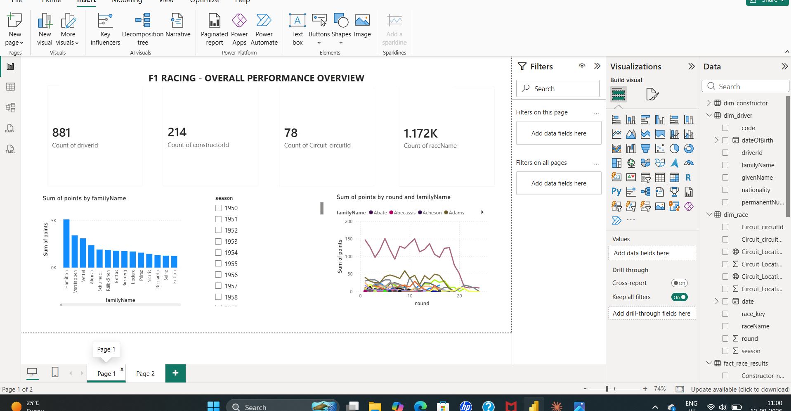
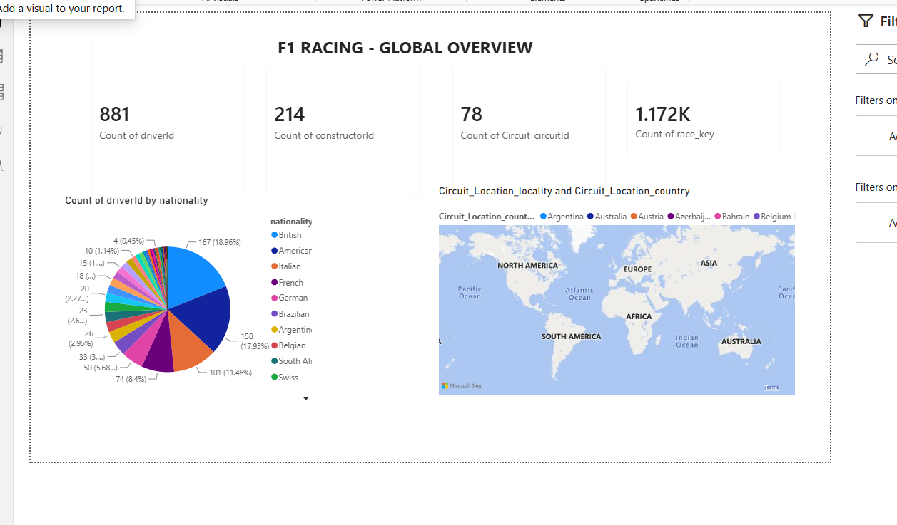

# F1 Data Pipeline and Power BI Dashboard

An end-to-end data engineering project that pulls the full history of
Formula 1 (1950-present) from a public API, runs it through a
medallion-architecture pipeline on Azure Data Lake Storage, and serves a
two-page Power BI dashboard.

## Architecture

```
Ergast API
   |
   v
Raw layer          (raw-data)          -- untouched JSON, as returned by the API
   |
   v
Ingested layer      (ingested-data)     -- flattened, typed, parquet
   |
   v
Presentation layer  (presentation-data) -- star schema: fact + dimension tables
   |
   v
Power BI            -- data model, relationships, two-page report
```

Five source entities are pulled from the API: `races`, `drivers`,
`constructors`, `circuits`, and `results`. The Presentation layer reshapes
these into a proper star schema:

- `fact_race_results` -- one row per driver per race per entry
- `dim_driver`
- `dim_constructor`
- `dim_race` (includes circuit name and lat/long, for the map visual)

## Stack

- **Source**: [Ergast API](http://ergast.com/mrd/) (via the
  [Jolpica](https://github.com/jolpica/jolpica-f1) community mirror, since
  the original Ergast endpoint was sunset)
- **Storage**: Azure Data Lake Storage Gen2 (3 containers: raw, ingested,
  presentation)
- **Transform**: Azure Databricks (PySpark) for ingestion and transformation; a Python/pandas version of the same logic is included as `01_ingest_and_transform.py`
- **BI**: Power BI Desktop

## Databricks and the pandas script

The pipeline was built on Azure Data Factory and Azure Databricks. In Databricks, I [describe: e.g. ingested the Ergast data from the API, flattened it, and wrote the ingested and presentation layers to ADLS Gen2].

`01_ingest_and_transform.py` is a standalone Python/pandas implementation of the same ingest and transform logic. I wrote it because [your real reason: e.g. Databricks compute access ended with my training account, and I wanted a version that runs without a workspace]. It reproduces the same three layers (raw, ingested, presentation) using a SAS token to read and write Blob storage.

## Running it

1. Generate a SAS token for your storage account (Azure Portal -> Storage
   Account -> Shared access signature) with Read/Write/List/Create
   permissions on the Container and Object resource types.
2. Set it as an environment variable — never hardcode it:
   ```
   export F1_SAS_TOKEN="sv=...&sig=..."
   ```
3. Update `STORAGE_ACCOUNT` in `01_ingest_and_transform.py` to your own
   storage account name.
4. Run:
   ```
   python 01_ingest_and_transform.py
   ```

Fetching the full results history (1950-2026, ~55 seasons) takes several
minutes due to API pagination and rate limiting.

## Data quirks handled along the way

- **Relief drivers**: a handful of 1950s-60s races (particularly at the
  Indianapolis 500, which counted toward the championship at the time) have
  the same driver appearing twice in one race's results, having taken over a
  teammate's car mid-race. Handled with an `entry_seq` column rather than
  deduplicating the rows away.
- **API rate limiting**: fetching results season-by-season (rather than one
  long paginated loop) with retry/backoff was needed to reliably pull the
  full 1950-2026 history without silently losing seasons to `429` responses.

## Dashboard

**Page 1 — Performance overview**: season-by-season driver points (bar
chart), points progression by round (line chart), season slicer.

**Page 2 — Global overview**: KPI cards (driver / constructor / circuit /
race counts), drivers by nationality (pie chart), circuit locations
worldwide (map).




